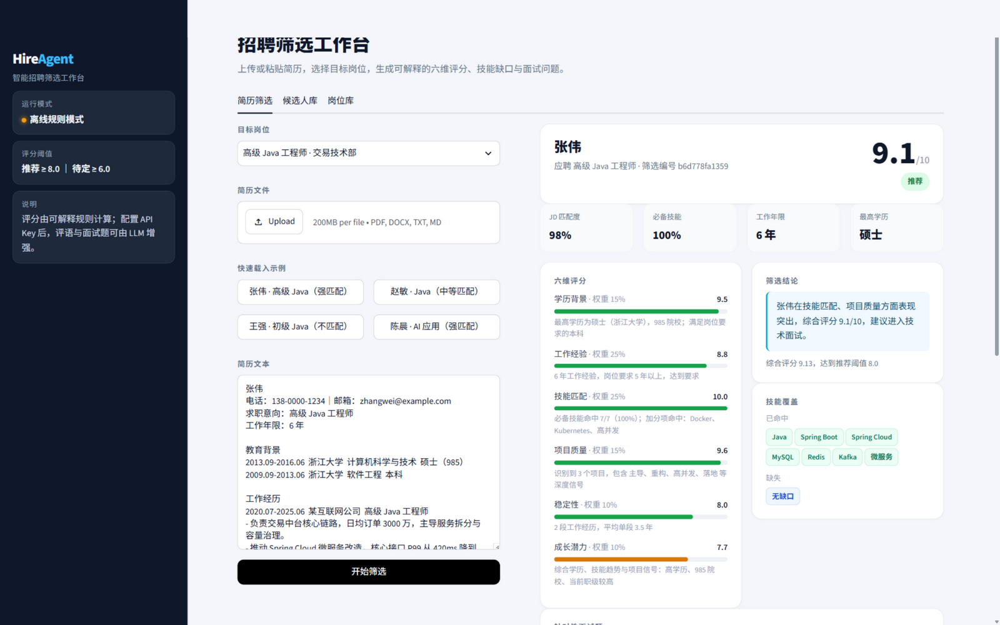
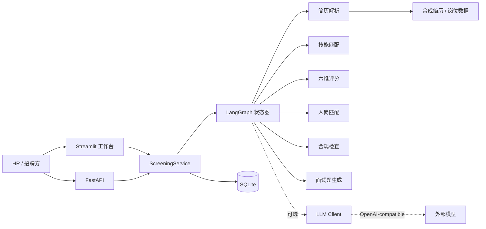
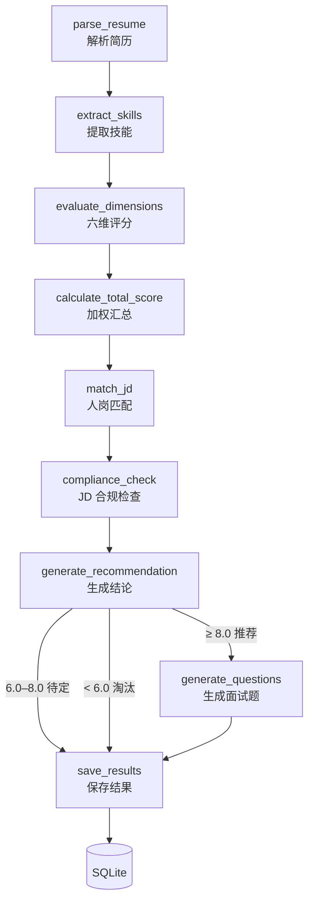

# HireAgent · 智能招聘筛选 Agent

[](https://github.com/yuweian195/hire-agent/actions/workflows/ci.yml)


面向中小团队招聘初筛场景的智能筛选系统。输入简历与目标岗位，输出六维评分、人岗匹配度、技能缺口、合规提示和针对性面试题；全流程由 LangGraph 状态图编排，并保留每个节点的执行轨迹。



> 仓库内简历与岗位均为合成样本，用于可复现的工程评估；接入真实数据时请替换 `data/` 目录，并遵守候选人隐私与数据合规要求。

## 业务背景

招聘初筛的真实问题不是“能不能调通大模型”，而是三件事：

1. **结果要可解释**：HR 需要知道 8.2 分是怎么来的，而不是一个黑盒结论。
2. **流程要可审计**：同一份简历重复筛选，结论应该稳定；敏感条件（性别、年龄、婚育）不能进入评分。
3. **能力要可落地**：解析、评分、匹配、面试题生成要能串成一条链路，而不是散落的 prompt。

HireAgent 把这条链路做成一个完整的单机服务：规则负责可解释的数值，LLM 负责语言理解与表达，二者解耦。

## 核心能力

- **简历解析**：支持 PDF / DOCX / TXT / Markdown，抽取姓名、联系方式、学历、院校层次、工作年限、技能、项目与工作经历。
- **六维评分**：学历、经验、技能、项目、稳定性、潜力，权重固定、结果确定，单份简历毫秒级完成。
- **人岗匹配**：必备技能命中率、加分技能、经验年限、学历要求综合计算匹配度，并给出缺口说明。
- **条件路由**：`≥ 8.0` 推荐并生成面试题；`6.0–8.0` 待定；`< 6.0` 淘汰。路由逻辑在 LangGraph 条件边中显式表达。
- **JD 合规检查**：识别性别、年龄、第一学历、婚育、户籍等歧视性条件，并从评分依据中剔除。
- **面试题生成**：围绕候选人已命中技能、缺失技能和项目经历生成技术题、项目题、行为题、场景题与岗位理解题。
- **可选的 LLM 增强**：兼容 OpenAI / DeepSeek / 通义等 OpenAI-compatible 接口；未配置 Key 时自动使用离线规则模式。
- **完整工程化**：FastAPI 接口、Streamlit 工作台、SQLite 持久化、pytest、Ruff、Docker Compose、GitHub Actions。

## 架构



## Agent 工作流



每个节点都会记录耗时与摘要，工作台中可以直接展开“Agent 执行轨迹”查看。

## 评分模型

| 维度 | 权重 | 计算依据 |
|---|---:|---|
| 学历背景 | 15% | 最高学历、院校层次（985/211）、是否满足岗位学历要求 |
| 工作经验 | 25% | 工作年限与岗位最低年限的比值，分段映射到 1–10 分 |
| 技能匹配 | 25% | 必备技能命中率 75% + 加分技能命中率 25%，必备命中率过低时封顶 |
| 项目质量 | 15% | 项目数量 + 主导/架构/重构/高并发/落地等深度信号 |
| 稳定性 | 10% | 工作经历段数与平均单段年限，跳槽频繁扣分 |
| 成长潜力 | 10% | 学历、院校、AI 相关技能、开源/专利/团队信号、当前职级 |

总分 = Σ（维度得分 × 权重）。阈值默认 `推荐 8.0 / 待定 6.0`，可通过环境变量调整。

## 快速开始

```bash
# 1. 创建环境
python -m venv .venv
# Windows
.venv\Scripts\activate
# macOS / Linux
source .venv/bin/activate

# 2. 安装
pip install -e ".[dev]"

# 3. 启动工作台
streamlit run ui/streamlit_app.py
```

浏览器打开 `http://localhost:8501`，左侧选择岗位、载入示例简历，点击“开始筛选”。

也可以单独启动 API：

```bash
uvicorn app.main:app --reload
```

- Swagger：`http://127.0.0.1:8000/docs`
- 健康检查：`GET /health`

## 配置真实 LLM（可选）

复制 `.env.example` 为 `.env`，填入任意 OpenAI-compatible 服务：

```dotenv
LLM_API_KEY=sk-xxx
LLM_BASE_URL=https://api.deepseek.com/v1
LLM_MODEL=deepseek-chat
```

配置后，**评语与面试题**会由 LLM 生成；**六维分数仍然由规则计算**，保证可复现、可测试。未配置 Key 或调用失败时，自动回退到离线模板。

## API 示例

```bash
curl -X POST http://127.0.0.1:8000/screen \
  -H "Content-Type: application/json" \
  -d '{
    "resume_text": "张伟\n工作年限：6 年\n技能：Java、Spring Cloud、MySQL、Redis",
    "job_id": "java-senior"
  }'
```

响应包含：

```json
{
  "candidate_name": "张伟",
  "total_score": 9.13,
  "recommendation": "recommend",
  "dimension_scores": ["...六维评分..."],
  "skill_match": {"matched": ["..."], "missing": ["..."]},
  "job_match": {"overall_rate": 0.98},
  "compliance": {"passed": true, "issues": []},
  "questions": ["...5 道面试题..."],
  "trace": ["...9 个节点..."]
}
```

其他接口：

| 方法 | 路径 | 说明 |
|---|---|---|
| GET | `/health` | 服务状态、LLM 模式、岗位数量 |
| GET | `/jobs` | 岗位列表 |
| POST | `/screen` | 文本简历筛选 |
| POST | `/screen/upload` | 文件上传筛选（PDF/DOCX/TXT） |
| GET | `/screenings` | 最近筛选记录 |
| GET | `/screenings/{id}` | 单条筛选详情 |

## 评估结果

评估集包含 5 份合成简历、2 个岗位，覆盖推荐 / 待定 / 淘汰三档。完整报告见 [`reports/evaluation.md`](reports/evaluation.md)。

| 指标 | 结果 |
|---|---|
| 决策准确率 | **5/5（100%）** |
| 分数区间命中 | **5/5（100%）** |
| 平均单份耗时 | **14 ms** |
| P95 耗时 | **29 ms** |

```bash
python scripts/evaluate.py
```

> 评估标签按岗位要求人工标注，分数区间用于检查评分量级是否合理；这不是大规模基准测试。

## 目录结构

```text
hire-agent/
├── app/
│   ├── main.py                # FastAPI 入口
│   ├── config.py              # pydantic-settings 配置
│   ├── schemas.py             # API / 工作流共享模型
│   ├── db.py                  # SQLite 仓储
│   ├── graph/
│   │   ├── state.py           # LangGraph 状态定义
│   │   ├── nodes.py           # 9 个工作流节点
│   │   └── workflow.py        # 图构建与编译
│   ├── tools/
│   │   ├── resume_parser.py   # PDF/DOCX/TXT 解析与结构化
│   │   ├── skill_matcher.py   # 技能库与匹配
│   │   ├── scorer.py          # 六维评分
│   │   ├── jd_matcher.py      # 人岗匹配
│   │   ├── compliance.py      # JD 合规检查
│   │   └── question_generator.py
│   ├── llm/
│   │   ├── client.py          # OpenAI-compatible 客户端 + 降级
│   │   └── prompts.py
│   └── services/screening.py  # 业务编排
├── ui/streamlit_app.py        # 招聘工作台
├── data/
│   ├── jobs/                  # 岗位 JD
│   ├── resumes/               # 合成简历
│   └── fixtures/              # 评估标签
├── scripts/evaluate.py
├── tests/                     # 15 个单元/接口测试
├── reports/evaluation.md
├── Dockerfile
├── docker-compose.yml
└── .github/workflows/ci.yml
```

## 测试与 CI

```bash
pytest -q
ruff check app ui tests scripts
```

GitHub Actions 在每次 push / PR 时执行 Ruff 与 pytest。

## 设计取舍

- **数值用规则，语言用 LLM**：评分必须稳定、可解释、可单测；LLM 只负责评语和面试题。这样既保留大模型的语言能力，又避免“同样简历两次评分不同”。
- **先做技能词典，不先上向量检索**：技能匹配需要可审计的命中/缺失列表；向量召回适合保留到 JD 语义匹配阶段再引入。
- **SQLite 而不是 PostgreSQL**：单机工作台足够，部署成本低；仓储层已隔离，替换数据库不影响业务流程。
- **默认离线可跑**：没有 API Key 也能完成完整筛选与测试，降低部署门槛，也方便 CI。
- **明确边界**：当前版本聚焦单份简历筛选，不含多租户、鉴权、异步队列、批量导入与监控告警；这些属于生产化阶段。

## Roadmap

- [ ] 简历批量导入与去重
- [ ] JD / 简历向量召回与重排
- [ ] 评分校准：引入人工反馈与标注集
- [ ] 多租户、鉴权与操作审计
- [ ] 异步任务队列与筛选进度
- [ ] 私有化部署脚本与运行监控

## 说明

HireAgent 面向中小团队招聘初筛场景，提供可本地部署的完整实现：规则评分保证可解释与可复现，LLM 仅用于语言增强。

仓库内简历、岗位与评估标签均为合成数据，用于可复现的工程评估；接入生产数据时请替换 `data/` 目录，并遵守候选人隐私与数据合规要求。欢迎通过 Issue 交流评分模型与 Agent 工作流的设计。
